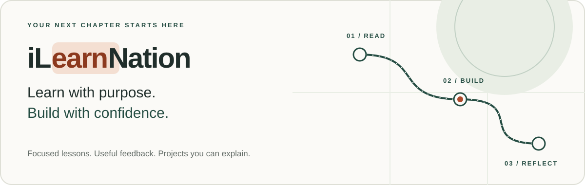

# iLearnNation



**Build something you can explain. Then make it better.**

iLearnNation brings focused lessons, runnable examples, thoughtful feedback, and
project work into one learning journey. It is for mixed self-directed learners:
fresh graduates, people revisiting the fundamentals, and curious builders from any
nation. Begin where you are, check the prerequisites, and take one useful next step.

[Start learning](courses/full-stack-modern-react-nextjs/getting-started.md) ·
[Explore the course](courses/full-stack-modern-react-nextjs/README.md) ·
[Course library](courses/README.md) ·
[Run the website](#run-the-learning-studio) ·
[Contribute](CONTRIBUTING.md) ·
[Support the project](#a-small-star-a-wider-learning-circle)

> [!NOTE]
> **An evolving learning studio.** The first course is original draft **0.1.0** with
> eight chapters. The website has a working local learning loop. Accounts,
> production CMS publishing, community features, and live integrations are future
> work; this README does not claim a verified hosted deployment or certified course.

## Find your starting point

| You want to… | Begin here |
| --- | --- |
| Understand the course before installing anything | Read [getting-started.md](courses/full-stack-modern-react-nextjs/getting-started.md). |
| Try a small coding checkpoint | Open [Foundations](courses/full-stack-modern-react-nextjs/chapters/foundations.md). |
| Use the interactive lesson player | [Run the website locally](#run-the-learning-studio), then open `/courses`. |
| Improve an explanation or contribute code | Read [Contributing](CONTRIBUTING.md) and the [project contract](AGENTS.md). |

## The learning route

**Read → Run → Change → Check → Reflect → Build**

Read one focused idea. Run the example, change something meaningful, and check the
result. Use a hint when you need one. Explain what changed in your own words, then
carry the idea into a project. Getting stuck and debugging are part of the practice.

Each chapter includes objectives, prerequisites, estimated effort, a concise
explanation, a runnable checkpoint, an exercise, progressive hints, common mistakes,
accessibility notes, reflection, and references. Native Markdown disclosures keep
hints close without revealing everything at once. Static diagrams are the default;
optional chapter animations are decorative and finite.

## First course: modern full-stack React and Next.js

**Full-Stack Modern React and Next.js Application Development**

The full course content belongs in **this repository under `courses/`**, alongside
the website, validators, and tests. The dedicated
[course repository](https://github.com/proffesergio/modern-fullstack-react-projects-building)
provides another entry point for learners. A website consuming that remote selects
a reviewed immutable commit; the two copies are not automatically synchronized.

| Stage | Chapter | What you will practice |
| --- | --- | --- |
| 01 · Orient | [Foundations](courses/full-stack-modern-react-nextjs/chapters/foundations.md) | Environment checks and a first component |
| 02 · Express | [JavaScript and TypeScript](courses/full-stack-modern-react-nextjs/chapters/javascript-typescript.md) | Data transformations and runtime checks |
| 03 · Compose | [React components](courses/full-stack-modern-react-nextjs/chapters/react-components.md) | State, events, and labeled forms |
| 04 · Route | [Next.js routing](courses/full-stack-modern-react-nextjs/chapters/nextjs-routing.md) | Layouts and server/client boundaries |
| 05 · Connect | [Data and forms](courses/full-stack-modern-react-nextjs/chapters/data-and-forms.md) | Validation, persistence, and identity concepts |
| 06 · Strengthen | [Quality, accessibility, and security](courses/full-stack-modern-react-nextjs/chapters/quality-accessibility-security.md) | Testing, keyboard access, and safer defaults |
| 07 · Ship thoughtfully | [Production workflows](courses/full-stack-modern-react-nextjs/chapters/production-workflows.md) | Git, CI, deployment concepts, and rollback |
| 08 · Make it yours | [Capstone](courses/full-stack-modern-react-nextjs/chapters/capstone.md) | A private learning notebook and project review |

**Start with the guide; finish with something you understand.** The dependency-free
Node checkpoints demonstrate individual ideas. React/Next.js extensions require
the framework environment described in the lessons; the checkpoints alone do not
create a complete full-stack app. The curriculum still needs human review.

## Inside the learning studio

| Available locally | How it behaves |
| --- | --- |
| Homepage, catalog, and chapter player | Read the course through a responsive interface with restrained visual accents. |
| First interactive JSX checkpoint | Edit a text-only heading and receive deterministic feedback, hints, and reset controls. |
| Explicit progress controls | Save, restore, or clear version-scoped progress on your own device. |
| Curriculum draft workbench | Edit tab-local Markdown drafts, validate content, and download review bundles. |
| Algorithm shadow lab | Replay synthetic events against versioned policies with explanations and zero live points. |
| Learning globe and list | Explore clearly labeled synthetic broad-region activity; no real learner locations. |

The first exercise validates a deliberately small JSX grammar; it does not execute
arbitrary learner JavaScript. The admin workbench has no production privileges or
persistent CMS publishing. In production, `/admin` defaults to **404**. There is no
learner account database, analytics collection, or live Mapbox renderer yet.

## Run the learning studio

Use **Node.js 24 LTS** for the checked development environment, npm, and Python 3.12+
for the documentation checks. From this repository's root:

```sh
npm ci
npm run dev
```

Open **http://127.0.0.1:3000**, choose the course, and start reading. `/admin` is a
local draft preview during development. The default bundled course needs no account
or service credentials. Keep credentials in ignored local configuration files.

<details>
<summary>Validation commands for contributors</summary>

```sh
npm test                 # Native unit tests and trusted authored checkpoints
npm run course:validate  # Validate the versioned course manifest
npm run typecheck        # Check TypeScript
npm run lint             # Check application lint rules
npm run format:check     # Check formatting
npm run build            # Build the production website
npm run test:e2e          # Desktop/mobile browser flows; run after build
python3 scripts/check_repository.py
python3 scripts/check_secrets.py
```

Browser checks cover the first lesson flow, progress controls, hostile Markdown,
keyboard behavior, reduced motion, and representative automated accessibility.
They do not establish complete WCAG conformance or production security readiness.
See the [development runbook](docs/runbooks/local-development.md) for details.

</details>

## A repository with clear boundaries

```text
apps/web/                         Learner website and local admin preview
courses/                          Catalog and included course directories
packages/course-schema/           Manifest validation
packages/course-runtime/          Constrained exercise and progress rules
packages/algorithm/               Versioned shadow policies and replay
packages/data/                    Bounded, immutable GitHub reads
scripts/                          Content checks, export, and manual import
tests/                           Unit/content tests and browser flows
docs/                            Architecture, decisions, research, and runbooks
.github/workflows/                Repository and application CI definitions
```

Keep the actual course files tracked under
`courses/full-stack-modern-react-nextjs/` so a normal platform clone includes the
lessons. `courses/README.md` is only the library catalog. The course keeps its
separate Git history in ignored local storage; see the
[preserve-history guide](docs/runbooks/include-courses-in-platform.md) for operating
on each repository explicitly. Neither repository automatically updates the other.

For architecture and continuation, read [ADR 0001](docs/adr/0001-course-source-and-admin-boundaries.md),
[project state](docs/context-memory/project-state.yaml), and [TODO.md](TODO.md).
The [GitHub/Vercel runbook](docs/runbooks/github-vercel-resume.md) covers remote
lesson selection and deployment; local env files do not configure hosted services.

## Build the next useful thing together

Useful contributions include a clearer explanation, a reproducible bug report,
an accessibility improvement, a better hint, or a tested code change. Small,
reviewable changes are welcome. Describe the learner outcome and show how you
checked it. Follow the [contribution guide](CONTRIBUTING.md),
[code of conduct](CODE_OF_CONDUCT.md), and [security guidance](SECURITY.md).

The next milestones are deeper project exercises, human curriculum review, and
verified remote lesson delivery. Authenticated CMS persistence and learner privacy
controls come before account-based features. Teams, reviews, healthy leaderboards,
and an opt-in aggregated map remain roadmap ideas until their foundations are ready.
See the [outcome backlog](TODO.md); unchecked items are plans, not shipped features.

## A small star, a wider learning circle


If a lesson helped you understand something, or this approach is something you
want to follow, **[give iLearnNation a star on GitHub](https://github.com/proffesergio/ilearnation)**
using the repository's **Star** button. It is a simple way to bookmark the project
and show appreciation. You can also share a useful chapter, report a confusing
step, or help improve it. Participation never depends on leaving a star.

**Thank you to every learner who asks a question, every reviewer who explains a
mistake kindly, and every contributor who makes the next step clearer.**

## Respect people, sources, and permissions

Learning here does not promise employment, income, or credentials. Progress on a
device is self-reported practice, not proof of mastery. Never commit private learner
data, tokens, or production records. Exact learner locations are outside the product's scope.

Original code and curriculum licenses have not been selected; this repository does
not currently grant an open-source or course reuse license. Consult the
[course references](courses/full-stack-modern-react-nextjs/references.md) for source
status. Reference PDFs stay local and excluded from Git and release artifacts;
see [reference handling](refBooks/README.md). No book text or code is redistributed
by these lessons.
