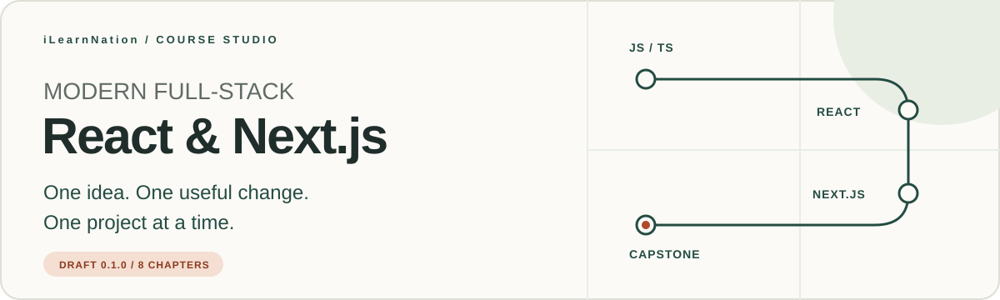

# Full-Stack Modern React and Next.js Application Development



**Learn the idea. Change the code. Explain what happened.**

An iLearnNation course for mixed self-directed learners. You do not need a CSE
degree to begin: check the prerequisites, choose one manageable goal, and practice
at your own pace. The destination is a project you understand well enough to test,
debug, and explain.

[Start here](getting-started.md) · [First checkpoint](chapters/foundations.md) ·
[Chapter roadmap](#your-chapter-roadmap) · [References](references.md) ·
[Support the course](#help-the-next-learner-find-their-way)

> [!NOTE]
> **Original draft 0.1.0.** Eight chapters and dependency-free JavaScript checkpoints
> are available. React/Next.js practice extensions require their declared framework
> environment. The curriculum still needs human review; reading or self-marking
> progress does not verify mastery or award a credential.

## Your first ten minutes

Begin with **[getting-started.md](getting-started.md)**. Understand the course goal,
check the proposed prerequisites, find your place in the roadmap, and write one
sentence about something you want to learn. Orientation comes before installation.
Ten minutes is an estimate, not a deadline.

The proposed starting knowledge is basic HTML/CSS, JavaScript variables and
functions, and navigating an editor and terminal. If a topic is unfamiliar, use
the preparation tasks rather than rushing past it. Your learning goal and reflection
notes can stay private; no public profile, fork, or progress post is required.

## The practice loop

**Read → Run → Change → Check → Reflect → Build**

Every chapter supplies objectives, prerequisites, estimated effort, a focused
explanation, a runnable checkpoint, exercises, progressive hints, reset instructions,
validation, common mistakes, accessibility notes, reflection, and references.

Try the checkpoint before revealing a hint. Change one thing and observe the
result. Read an error as feedback about the program, then explain your fix in your
own words. Carry the idea into the chapter's framework extension or capstone.

## Your chapter roadmap

| Step | Chapter | Practice focus |
| --- | --- | --- |
| 01 · Get oriented | [Foundations](chapters/foundations.md) | Environment checks, browser/server responsibilities, and a first component |
| 02 · Work with data | [JavaScript and TypeScript](chapters/javascript-typescript.md) | Immutable transformations, types, and runtime checks |
| 03 · Build interfaces | [React components](chapters/react-components.md) | Props, state transitions, events, and labeled forms |
| 04 · Connect the routes | [Next.js routing](chapters/nextjs-routing.md) | Layouts, data states, and server/client boundaries |
| 05 · Handle real inputs | [Data and forms](chapters/data-and-forms.md) | Validation, ownership, identity concepts, and persistence |
| 06 · Prove the behavior | [Quality, accessibility, and security](chapters/quality-accessibility-security.md) | Regression checks, keyboard review, and safer links |
| 07 · Prepare to ship | [Production workflows](chapters/production-workflows.md) | Git, reproducible CI, deployment concepts, and recovery |
| 08 · Make it yours | [Capstone](chapters/capstone.md) | A private learning notebook with tests, a README, and a retrospective |

The capstone is learner project work. The Node checkpoints demonstrate individual
concepts; they do not generate a complete React/Next.js application. Keep the
chapter acceptance criteria and actual evidence beside your implementation.

## Run your first checkpoint

Use **Node.js 24 LTS**, an editor, and a terminal. The authored examples were checked
locally with Node 24.14.0. No package installation, secret keys, or cloud account is
needed for the dependency-free checkpoints.

You can read online, or clone the dedicated course repository:

```sh
git clone https://github.com/proffesergio/modern-fullstack-react-projects-building.git
cd modern-fullstack-react-projects-building
node --version
```

Open [Foundations](chapters/foundations.md), copy its JavaScript checkpoint into a
`checkpoint.mjs` file in your own practice folder, then run it from that folder:

```sh
node checkpoint.mjs
```

Read the result, make the requested change, and rerun its assertions. Each chapter
explains its own reset and validation steps. A checkpoint file is something you
create from the lesson, not a generated starter already present in this repository.

## Where this course lives

| Location | What belongs there |
| --- | --- |
| This dedicated course repository | This README, `getting-started.md`, `course.json`, `chapters/`, `assets/`, and `references.md` |
| `courses/full-stack-modern-react-nextjs/` in [iLearnNation](https://github.com/proffesergio/ilearnation) | The same reviewed course content bundled with the website and its validators/tests |
| `courses/README.md` in the platform | A catalog linking to available courses; it is not a separate repository |

The interactive lesson player belongs to the **platform repository**. It includes
a bounded first JSX edit/check exercise and explicit device-only progress controls.
Follow the platform README to run the website. This standalone course has no root
`package.json`, web server, or platform test suite; do not run `npm ci` here.
Changes between the two repositories require reviewed commits and an explicit
source SHA. There is no automatic two-way synchronization.

<details>
<summary>Contributor checks in the platform repository</summary>

From the iLearnNation **platform root**, after its documented setup:

```sh
npm run course:validate
node --test tests/course-schema.test.mjs tests/course-content.test.mjs
```

These paths belong to the platform, not this standalone course. The checks execute
trusted authored fixtures only; learner code must not be passed to the content
harness. Follow the platform contribution guide for review and versioning.

</details>

## A comfortable reading experience

Essential instructions are text. Hints use native Markdown disclosures, and static
diagrams remain visible by default. Chapter GIFs are optional, decorative, and play
once for 2.4 seconds. GitHub may load them before a disclosure opens and cannot apply
OS reduced-motion preferences to GIFs. No animation is needed to complete a lesson.
The README banners are static. See [asset details](assets/README.md).

## Help the next learner find their way


If a chapter helped something click, consider **[starring this course repository](https://github.com/proffesergio/modern-fullstack-react-projects-building)**
using GitHub's **Star** button. It is an optional way to bookmark the course and show
appreciation. A clear bug report, a kinder explanation, or an accessibility fix is
another useful contribution. Access and participation never depend on a star.

**Thank you for asking thoughtful questions, explaining mistakes kindly, and helping
the next learner take one clearer step.**

## Sources, permissions, and learner privacy

The lessons and diagrams are original project work. [References](references.md)
record source URLs, authors, dates, status, and supported chapters. No reference
book or private PDF is included. Code/curriculum reuse licenses remain unselected;
this repository does not currently grant an open-source or course reuse license.

Keep tokens, production records, and personal learner data out of coursework and
commits. Work with synthetic data and choose what you share. The course does not
promise income, employment, or credentials.
